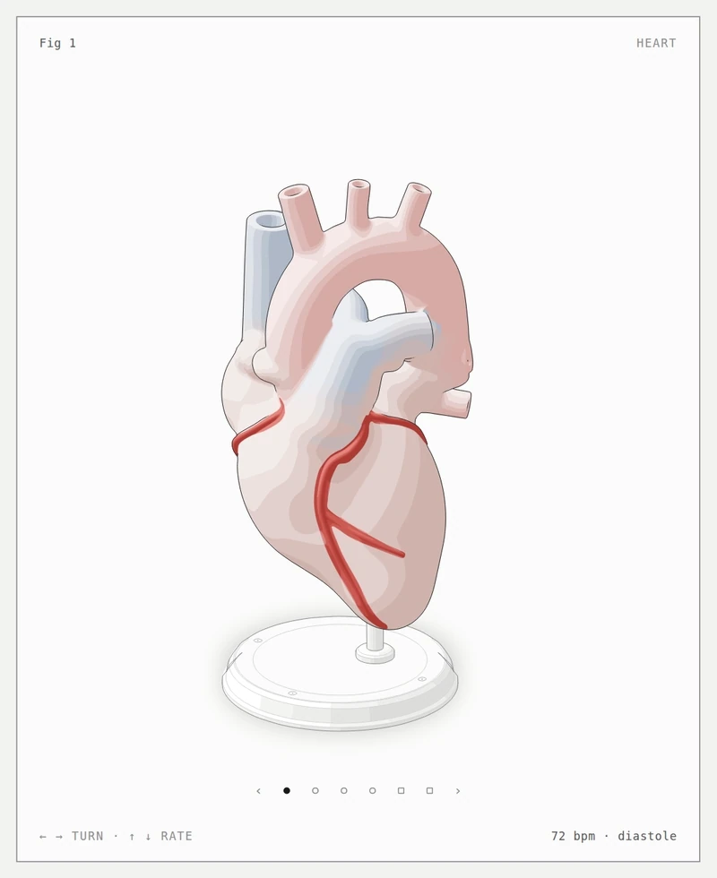
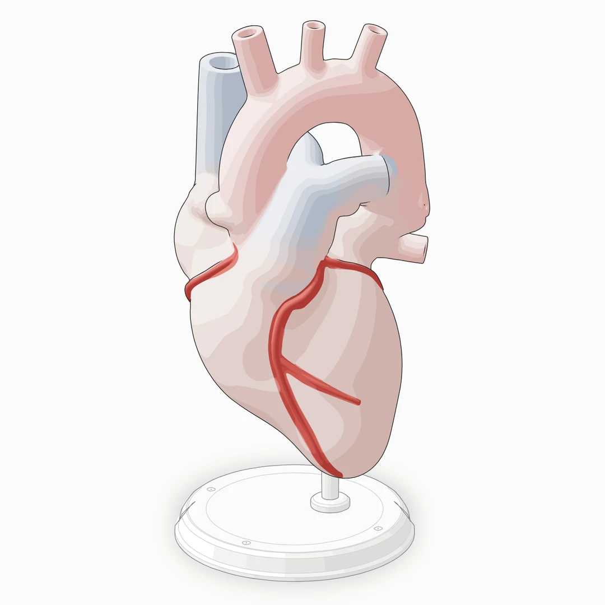
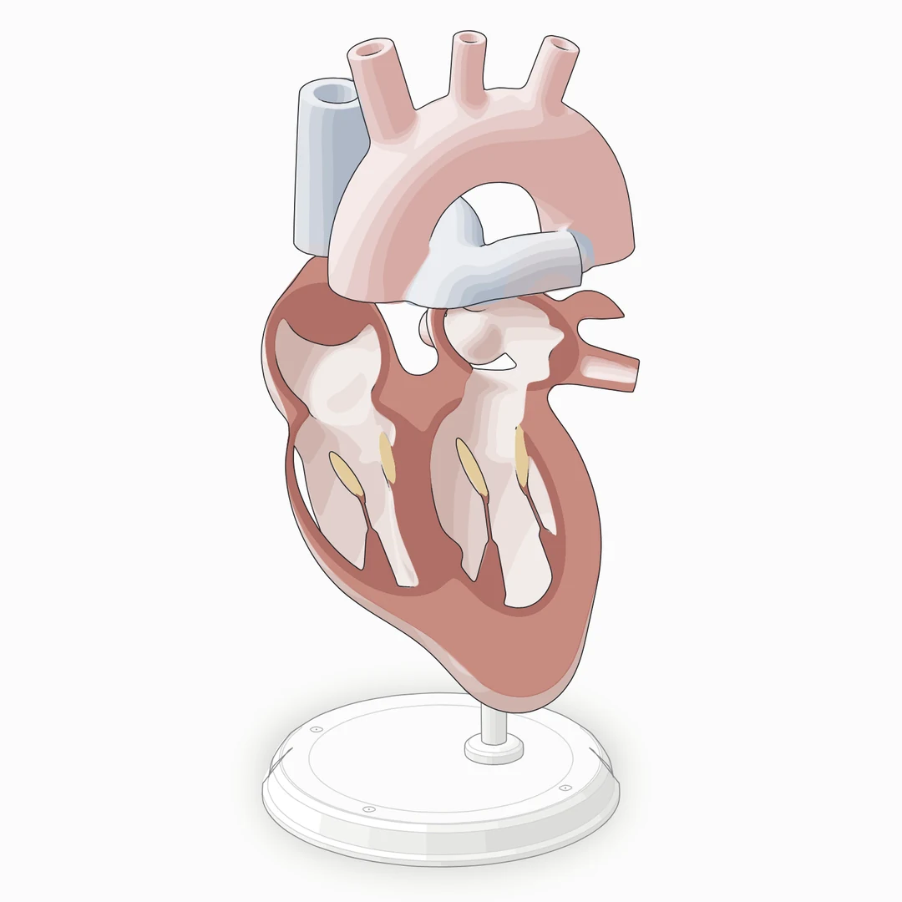
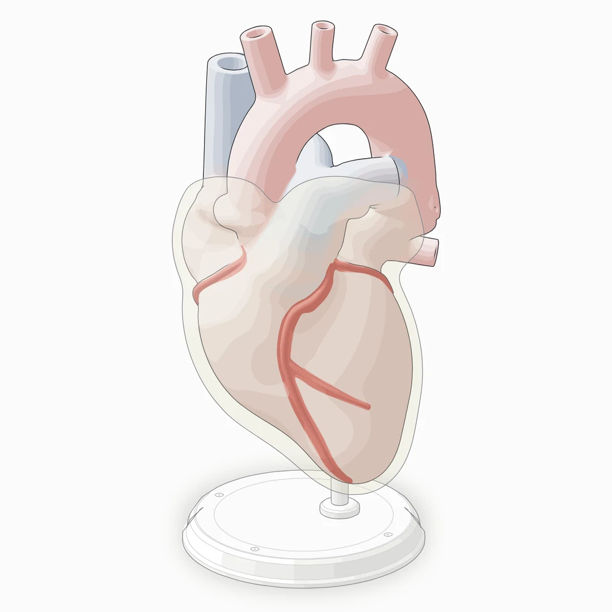
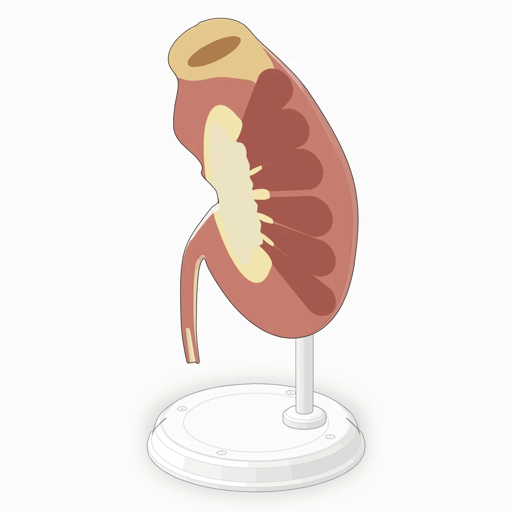
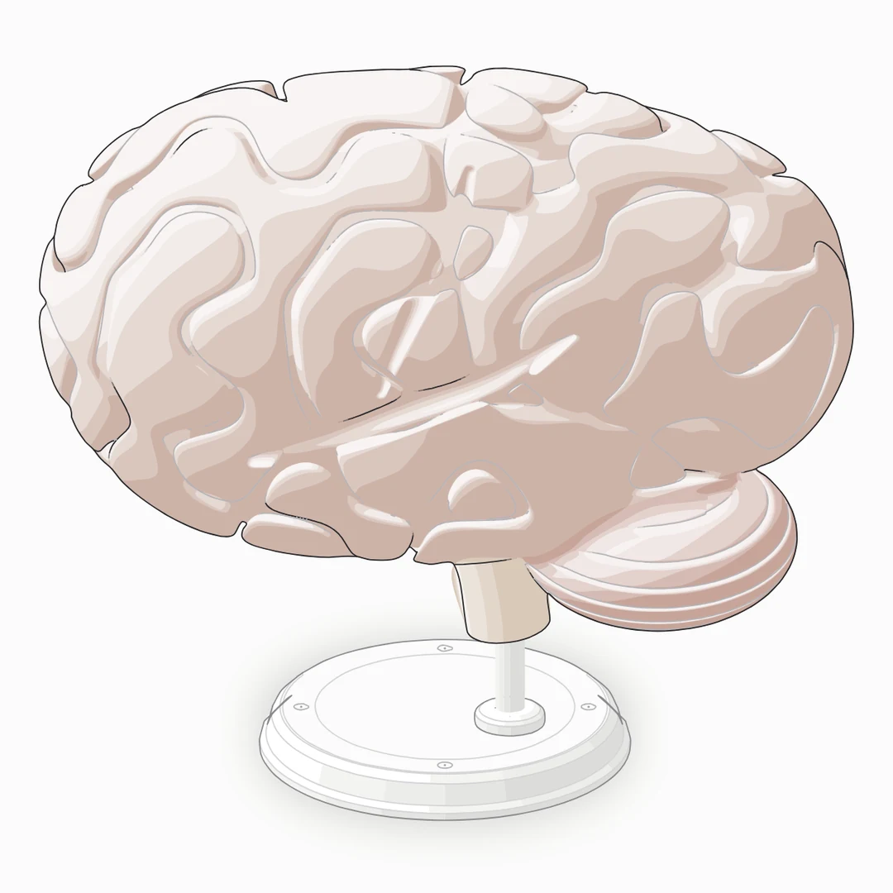
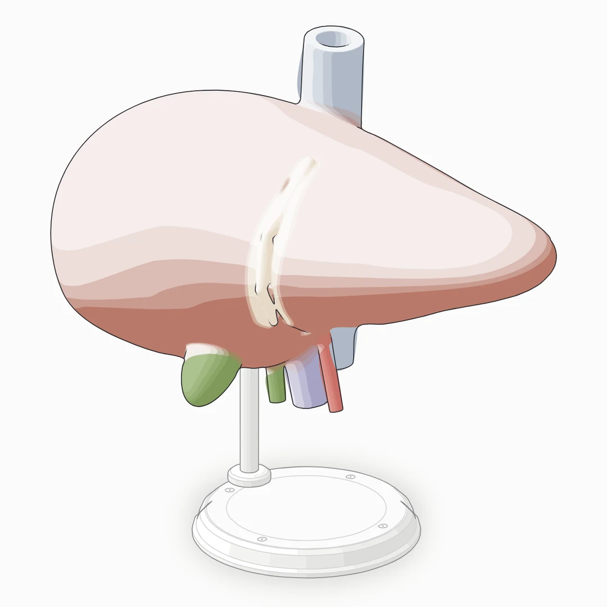
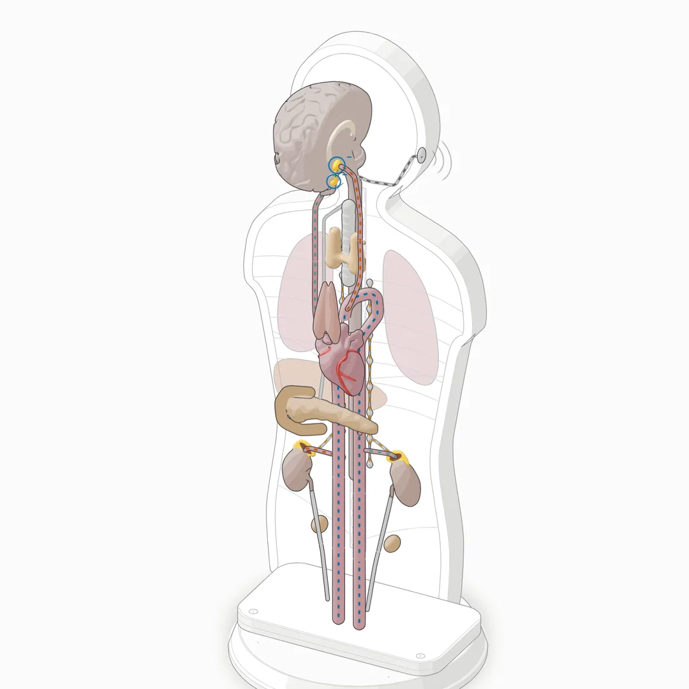

<p align="right"><a href="README.md">English</a> · <b>Español</b></p>

<h1 align="center">specimen</h1>

<p align="center"><b>Una skill de Claude Code que dibuja anatomía como un modelo didáctico isométrico e interactivo.</b><br>Órganos y vasos hechos con campos de distancia suaves, abiertos por planos anatómicos reales o vistos a través de una membrana, sobre una peana de aula, en SVG.</p>

<p align="center">
  <a href="https://julianolarteramos.github.io/specimen/"></a>
  <a href="https://github.com/julianolarteramos/specimen/actions/workflows/ci.yml"></a>
  <a href="LICENSE"></a>
  <a href="#requisitos"></a>
  <a href="#requisitos"></a>
  <a href="https://code.claude.com/docs/en/skills"></a>
</p>

<p align="center">
  <a href="#instalación">Instalación</a> ·
  <a href="#primeros-pasos">Primeros pasos</a> ·
  <a href="#galería">Galería</a> ·
  <a href="#cómo-funciona">Cómo funciona</a> ·
  <a href="#ejemplos">Ejemplos</a> ·
  <a href="#límites">Límites</a> ·
  <a href="#créditos">Créditos</a>
</p>

<p align="center">
  <a href="https://julianolarteramos.github.io/specimen/heart.html"></a>
</p>

<p align="center"><sub><code>examples/heart</code>, tema claro, un clip de 10 s grabado cuadro a cuadro desde la página (<a href=".github/assets/heart-demo.mp4">MP4</a>; también el del <a href=".github/assets/endocrine-demo.mp4">sistema endocrino</a>). <a href="https://julianolarteramos.github.io/specimen/">Abre la demo en vivo</a>: arrastra o usa las flechas para girarlo, y arriba y abajo para cambiar la frecuencia cardiaca.</sub></p>

---

## Qué hace

Pide una figura anatómica y specimen construye el objeto que un profesor pondría sobre la mesa: un modelo del órgano en proporciones reales, con las partes que el estudiante tiene que nombrar, sobre una peana torneada y una varilla. La figura es una tarjeta enmarcada con título, una indicación de uso y una lectura en vivo, con leyenda y pie de figura debajo, y un movimiento tranquilo que sale de un modelo pequeño (el corazón late a los bpm que muestra la lectura).

- **Órganos hechos de campos.** Cada órgano es un solo campo de distancia con signo, de lóbulos, cavidades y vasos fundidos, sombreado en cuatro tonos con colores de tejido sobrios y uniones graduadas entre tejidos. Los vasos que salen del espécimen terminan en un corte plano con su luz.
- **Vistas.** Unos pocos acimuts de cámara se generan de antemano y se funden en la tarjeta. Cada vista pasa su propia auditoría.
- **Cortes.** Un plano a través del órgano con su propio tejido de corte: el corte de cuatro cavidades del corazón, el corte coronal del riñón.
- **Membranas.** Un velo translúcido sobre el órgano, como el pericardio.
- **Salida.** Una página HTML autocontenida, un SVG suelto o componentes de React/Next.js, en claro u oscuro. El tema claro es el que se diseña primero.

Las piezas de máquina del kit original (sólidos torneados, tubos, cables, instrumentos) siguen ahí para peanas y aparatos, y los ejemplos de máquinas siguen construyéndose. Este es el más pequeño, un comparador de reloj:

<p align="center"></p>

## Galería

<table>
  <tr>
    <td width="50%"><a href="https://julianolarteramos.github.io/specimen/heart.html"></a></td>
    <td width="50%"><a href="https://julianolarteramos.github.io/specimen/heart.html"></a></td>
  </tr>
  <tr>
    <td><sub><b>Corazón, exterior.</b> Cavidades, orejuelas, los grandes vasos con sus cortes y las arterias coronarias en un solo campo, con cuatro tejidos y uniones graduadas.</sub></td>
    <td><sub><b>Corazón, corte de cuatro cavidades.</b> Un plano tallado a través de todas las cavidades; la cara de corte tiene su propio tejido y un borde endocárdico más oscuro.</sub></td>
  </tr>
  <tr>
    <td><a href="https://julianolarteramos.github.io/specimen/heart.html"></a></td>
    <td><a href="https://julianolarteramos.github.io/specimen/kidney.html"></a></td>
  </tr>
  <tr>
    <td><sub><b>Corazón, pericardio.</b> El campo del órgano engrosado unos milímetros y dibujado al final como velo: un tejido, un brillo, un contorno.</sub></td>
    <td><sub><b>Riñón, corte coronal.</b> Corteza, pirámides medulares, cálices y pelvis, coloreados en la cara de corte por los núcleos del campo; la suprarrenal sobre el polo superior.</sub></td>
  </tr>
  <tr>
    <td><a href="https://julianolarteramos.github.io/specimen/brain.html"></a></td>
    <td><a href="https://julianolarteramos.github.io/specimen/liver.html"></a></td>
  </tr>
  <tr>
    <td><sub><b>Cerebro, hemisferio izquierdo.</b> Circunvoluciones talladas en la corteza por un campo de banda limitada, más la cisura lateral y el surco central; folias del cerebelo.</sub></td>
    <td><sub><b>Hígado.</b> Lóbulos, ligamento falciforme, vesícula biliar, los vasos del hilio y la vena cava inferior.</sub></td>
  </tr>
  <tr>
    <td colspan="2" align="center"><a href="https://julianolarteramos.github.io/specimen/endocrine-es.html"></a></td>
  </tr>
  <tr>
    <td colspan="2"><sub><b>Sistema endocrino.</b> Un medio torso con las glándulas, los vasos y los nervios como campos, que reproduce la respuesta al estrés con un solo modelo: la vía rápida del simpático a la médula suprarrenal, la vía lenta de CRH, ACTH y cortisol, y el freno del cortisol sobre el hipotálamo y la hipófisis.</sub></td>
  </tr>
</table>

Cada imagen es la página clara de [`examples/`](examples), capturada con el propio [`scripts/drive.mjs`](scripts/drive.mjs) de la skill. Las páginas generadas están en el repositorio: puedes abrir cualquier `.html` de `examples/` directamente, o usar la [demo en vivo](https://julianolarteramos.github.io/specimen/).

## Instalación

specimen es una [Agent Skill](https://agentskills.io): una carpeta con `SKILL.md` en la raíz, y este repositorio es esa carpeta.

Como plugin de Claude Code, desde el marketplace de este repositorio. En una sesión de Claude Code:

```text
/plugin marketplace add julianolarteramos/specimen
/plugin install specimen@specimen
```

o en un solo paso desde la terminal, con Claude Code 2.1.275 o posterior:

```sh
claude plugin install specimen --marketplace julianolarteramos/specimen
```

Claude Code antepone el nombre del plugin a sus skills, así que la skill del plugin es `/specimen:specimen`; Claude también la carga solo cuando pides una figura anatómica. Para actualizar, ejecuta `/plugin marketplace update specimen` y luego `/plugin update specimen@specimen`. El plugin copia el repositorio completo, ejemplos incluidos.

Con la CLI [`skills`](https://github.com/vercel-labs/skills):

```sh
npx skills add julianolarteramos/specimen
```

Eso la instala en el proyecto actual; agrega `-g` para instalarla para tu usuario, y `-a claude-code` para saltarte la pregunta de qué agentes configurar. La CLI copia el repositorio completo, ejemplos incluidos.

A mano, clónalo en una carpeta de skills de modo que `SKILL.md` quede en `<carpeta de skills>/specimen/SKILL.md`:

```sh
git clone https://github.com/julianolarteramos/specimen.git .claude/skills/specimen
```

Usa `~/.claude/skills/specimen` para tenerla en todos los proyectos. Para actualizar, `git pull` dentro de esa carpeta. Claude Code detecta skills nuevas en una sesión abierta; si la carpeta `skills` no existía al empezar la sesión, ejecuta `/reload-skills`.

La skill sigue el formato abierto de Agent Skills, así que Antigravity, OpenCode, Codex y MiniMax Code también pueden cargarla desde sus carpetas de skills (`SKILL.md` los menciona). Está escrita y probada para Claude Code. En Codex, los chequeos arrancan Chrome sin interfaz y su sandbox puede bloquearlo; permite esos comandos o corre los chequeos tú en una terminal.

## Primeros pasos

En Claude Code, escribe `/specimen` y di qué debe enseñar la figura:

```text
/specimen un modelo de corazón de aula para una clase de fisiología: late a 72 bpm, gira y se abre por el plano de cuatro cavidades. Una página HTML, tema claro.
```

```text
/specimen un riñón izquierdo abierto por su plano coronal, con la suprarrenal cortada para mostrar corteza y médula, para una diapositiva sobre la respuesta al estrés
```

```text
/specimen la mitad izquierda de un cerebro sobre una peana, con el surco central y la cisura lateral bien visibles, como un SVG suelto para un artículo
```

No hace falta nombrar la skill: Claude también la carga cuando pides una ilustración anatómica, un diagrama de un órgano para una clase o una diapositiva, o una figura interactiva de fisiología. Lo que más ayuda:

1. **Di qué debe enseñar.** Qué estructuras se tienen que ver, qué corte o membrana, y los números reales (tamaños en mm, frecuencias).
2. **Di dónde va a vivir.** Una página HTML, un SVG suelto o un componente de React/Next.js; claro u oscuro.
3. **Cuenta con una sesión larga.** La skill genera, audita y captura cada vista, y revisa los acercamientos antes de dar la figura por terminada.

La figura llega como código tuyo: un script de Node que genera las páginas, junto con el kit.

Las páginas de ejemplo están en inglés (el sistema endocrino también tiene la suya en español); los textos (título, indicaciones, leyenda y pie) salen de cada script de construcción. Si pides la figura en español, pide también que esos textos vayan en español.

## Cómo funciona

- **Campos de distancia** ([`kit/blob.mjs`](kit/blob.mjs)). Un órgano se arma con esferas, elipsoides, conos redondeados y cadenas de vasos, unidos con una unión suave polinómica, tallados, recortados por planos o escritos a mano; cada primitiva lleva su tejido.
- **Sombreado de cuatro tonos por ray marching.** Al construir, `paint` lanza un rayo por celda de pantalla (de grueso a fino), biseca cada cruce y contornea la silueta, cuatro bandas de luz, las capas de tejido y los contornos interiores en trazados SVG continuos. Con `tones: "overlay"` las bandas de luz son velos translúcidos sobre capas planas de tejido, lo que deja cada vista en decenas de kilobytes y no en cientos.
- **Auditoría en modo orgánico** ([`kit/audit.mjs`](kit/audit.mjs)). Los campos se registran con `A.field` y se auditan con `{ organic: true }`: el extremo de un vaso puede hundirse en un campo siguiendo su normal hacia dentro, las fusiones declaradas se excusan, y a cada campo se le revisan los límites y que su gradiente no supere su cota de Lipschitz. La peana se audita con las reglas de máquina: nada atraviesa nada y cada solapamiento se pinta en el orden de profundidad real.
- **Divisor de campos.** `B.split` corta un campo en piezas ordenables por profundidad a lo largo de planos bisectores, sin contorno en el corte, para que un vaso que pasa por delante de una parte y por detrás de otra se pueda ordenar.
- **Cortes y velos.** `B.halfspace`, `B.intersect` y los tejidos de corte de `carve` hacen los cortes; los `cores` del campo colorean la cara de corte. `B.grow` y `B.veilSvg` hacen las membranas, dibujadas al final con una opacidad declarada entre 0,08 y 0,55.
- **Chequeos en Chrome sin interfaz.** [`scripts/capture.mjs`](scripts/capture.mjs) y [`scripts/drive.mjs`](scripts/drive.mjs) toman capturas, acercamientos a 4× y hojas de contacto; [`scripts/lines.mjs`](scripts/lines.mjs) falla con cualquier línea que termine en el aire.
- **[`SKILL.md`](SKILL.md)** es lo que lee Claude: el flujo de trabajo (tamaño, primero la verdad, el espécimen y su montaje, la lista de partes, el campo, pintar y registrar, cortes y membranas, la tarjeta, el movimiento, la verificación) y las reglas de oficio. [`references/`](references) tiene las guías largas; la sección 15 de [`references/kit.md`](references/kit.md) es la API de campos.

## Ejemplos

Cada ejemplo tiene un script de Node que escribe una página oscura a su lado; agrega `--light` para el tema claro y `--audit` para auditar todas las vistas.

| Ejemplo | Qué muestra | Construir |
|---|---|---|
| [`heart`](examples/heart) | La referencia: un modelo de corazón de aula con cavidades, orejuelas, los grandes vasos con cortes y luces, y arterias coronarias. Cuatro vistas giradas, un corte de cuatro cavidades y una vista a través del pericardio; un modelo puro en `model.mjs` mueve el latido y la lectura de bpm. Tarda varios minutos por tema. | `node examples/heart/build.mjs` |
| [`kidney`](examples/kidney) | Un riñón izquierdo con su suprarrenal, entero y abierto por el plano coronal: corteza, pirámides medulares, cálices y pelvis en la grasa del seno, los vasos del hilio y el uréter. | `node examples/kidney/build.mjs` |
| [`brain`](examples/brain) | La mitad izquierda de un cerebro con circunvoluciones y surcos, la cisura lateral y el surco central, el cerebelo con sus folias y el tronco encefálico. | `node examples/brain/build.mjs` |
| [`liver`](examples/liver) | Un hígado con sus lóbulos derecho e izquierdo, el ligamento falciforme, la vesícula biliar, la vena porta, la arteria hepática y el colédoco en el hilio, y la vena cava inferior. | `node examples/liver/build.mjs` |
| [`endocrine`](examples/endocrine) | El sistema endocrino en la mitad posterior de un torso cortado en el plano coronal: la cara medial del encéfalo con el hipotálamo, la hipófisis y la pineal, la tiroides y las paratiroides sobre la tráquea, el timo, el corazón, el páncreas en el asa del duodeno, los riñones con sus suprarrenales abiertas, las gónadas, los grandes vasos y las cadenas simpáticas, el vago y un nervio aferente. Cinco vistas auditadas; un modelo puro en `model.mjs` reproduce en bucle la respuesta al estrés, con el tiempo y el paso en curso en la lectura y los cinco niveles en barras bajo el pie. Cada construcción escribe la página en inglés y otra en español (`endocrine-es.html`). La misma figura es el centro de una [presentación de clase sobre el sistema endocrino](https://julianolarteramos.github.io/sistema-endocrino/v3/) en 48 pasos. | `node examples/endocrine/build.mjs` |

El riñón, el cerebro y el hígado comparten un constructor, [`examples/shared/specimen.mjs`](examples/shared/specimen.mjs): peana y varilla, vistas generadas y auditadas en paralelo, y la tarjeta con fundido.

Los ejemplos de máquinas de Anatomy se conservan como referencia para montajes, instrumentos y las demás piezas del kit: `dial-indicator`, `desk-computer`, `arcade-cabinet`, `push-button`, `raptor-engine` y `ripple-tank` (WebGL), y los componentes de React `test-rig` y `spot-plate`. Una figura generada también se puede imprimir en PDF A4 o Carta con [`scripts/print.mjs`](scripts/print.mjs); ver [`references/print.md`](references/print.md).

## Requisitos

| | Para qué | Notas |
|---|---|---|
| **[Claude Code](https://code.claude.com/docs/en/overview)** | usar la skill | Otros agentes compatibles con Agent Skills también la cargan; ver [Instalación](#instalación). |
| **Node.js 20.10+** | construir, el kit, los chequeos | Solo módulos incorporados: no hay nada que instalar con `npm install`. |
| **Chrome o Chromium** | los chequeos | `capture.mjs`, `drive.mjs` y `lines.mjs` lo buscan en los lugares habituales de macOS, Linux y Windows y en la caché de Playwright; para otro binario, define `CHROME_PATH`. |
| **React 18+** | solo para salida en React | `kit/react/`, `examples/test-rig/` y `examples/spot-plate/`. |

## Límites

- **Un modelo didáctico, no un atlas.** Las superficies y los colores están simplificados a propósito, y las figuras no son una referencia médica.
- **Las circunvoluciones del cerebro son procedurales.** Salen de un campo de ruido de banda limitada tallado en la corteza; solo la cisura lateral y el surco central están puestos anatómicamente. El patrón de los demás pliegues no es el de un cerebro real.
- **La cara visceral del hígado está simplificada.** Es un solo plano que se encuentra con la cara anterior en el borde inferior afilado. Están el hilio con sus vasos, la vesícula en su fosa y la vena cava inferior en su surco, y el lóbulo caudado es un solo abultamiento; las impresiones de los órganos vecinos, el lóbulo cuadrado y las fisuras de la cara visceral no están modelados.
- **El sistema endocrino también es un modelo didáctico.** La cara medial del encéfalo es un corte plano, las glándulas pequeñas (hipotálamo, hipófisis, pineal, paratiroides) están a escala real y miden pocos píxeles a 1×, los pulmones y el hígado son incrustaciones planas en la cara de corte, y la red de vasos se reduce a los que llevan las hormonas del modelo.
- **Vistas pregeneradas, no 3D libre.** Cada vista es un SVG aparte de unos 35–185 KB (el medio torso del sistema endocrino, con sus muchos vasos, es el más pesado, con unos 175–185 KB; las del cerebro rondan los 95 KB); una página con tres a seis vistas pesa entre 170 y 970 KB. El giro salta entre vistas con un fundido.
- **Las páginas de ejemplo están en inglés,** salvo el sistema endocrino, que también viene en español. Sus títulos, indicaciones, leyendas y pies salen de cada script de construcción y se pueden traducir ahí.
- **Construir es lento.** Cada vista se calcula por ray marching al construir: el corazón tarda varios minutos por tema.
- **No es una librería de gráficos.** No hay ejes ni series; los números aparecen como lectura en vivo de un modelo.

## Créditos

specimen es un fork de **[Anatomy](https://github.com/wheresryan22/anatomy)**, de Ryan ([@wheresryan22](https://github.com/wheresryan22)), con licencia MIT. Anatomy es una skill que explica ideas técnicas como máquinas isométricas bien hechas, y todo lo que hace specimen se apoya en ella.

**Se conserva de Anatomy:** la cámara isométrica y el renderizador SVG (`iso-kit`), los constructores de tarjeta y página con su CSS, las piezas torneadas, tubos y cables (`lathe.mjs`, `tube.mjs`), la auditoría geométrica y su solucionador del orden de pintado, la capa WebGL, los componentes de React, los chequeos en Chrome (`capture.mjs`, `drive.mjs`, `lines.mjs`), las hojas imprimibles, los ejemplos de máquinas, la mayoría de las reglas de oficio y todo el historial de commits.

**Se agrega en specimen:** campos de distancia orgánicos (`kit/blob.mjs`) con sombreado de cuatro tonos por ray marching y capas de tejido; el modo orgánico de la auditoría, con chequeos de límites y de Lipschitz; cortes con tejidos de corte y núcleos de campo; el divisor de campos; velos para membranas; el constructor compartido de órganos; los ejemplos de corazón, riñón, cerebro, hígado y sistema endocrino; un `SKILL.md` y un `references/craft.md` reescritos como doctrina de specimen; el sitio de demostración.

**Se quita:** el modo 3D `turn` de Anatomy (beta), reemplazado por vistas pregeneradas y auditadas con fundido, y el publicador para la galería comunitaria de Anatomy. [`CHANGELOG.md`](CHANGELOG.md) registra cada cambio.

## Contribuir

Los issues y pull requests son bienvenidos. Lee primero [CONTRIBUTING.md](CONTRIBUTING.md) (en inglés): explica cómo construir los ejemplos, los chequeos, el sitio de demostración y las reglas de la casa (entre ellas, nada de comentarios en el código, y cambios en el kit que dejen cada ejemplo existente idéntico byte a byte). Sigue el [Código de conducta](CODE_OF_CONDUCT.md) y reporta problemas de seguridad como dice [SECURITY.md](SECURITY.md).

- [Reportar un error](https://github.com/julianolarteramos/specimen/issues/new?template=bug_report.yml)
- [Pedir una figura](https://github.com/julianolarteramos/specimen/issues/new?template=figure_request.yml)

## Licencia

[MIT](LICENSE). © 2026 Ryan (Anatomy) y © 2026 Julián Olarte (specimen).
