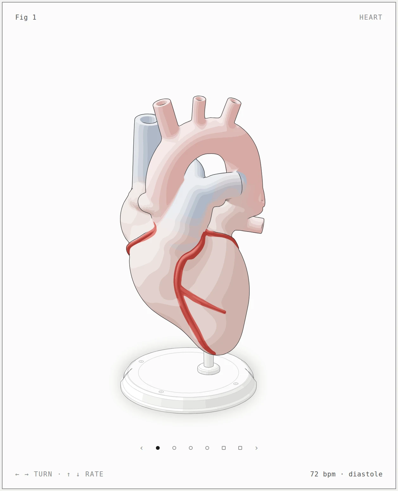

<p align="right"><b>English</b> · <a href="README.es.md">Español</a></p>

<h1 align="center">specimen</h1>

<p align="center"><b>A Claude Code skill that draws anatomy as an interactive isometric teaching model.</b><br>Organs and vessels from smooth distance fields, cut open along real planes or seen through a membrane, on a classroom stand, in SVG.</p>

<p align="center">
  <a href="https://julianolarteramos.github.io/specimen/"></a>
  <a href="https://github.com/julianolarteramos/specimen/actions/workflows/ci.yml"></a>
  <a href="LICENSE"></a>
  <a href="#requirements"></a>
  <a href="#requirements"></a>
  <a href="https://code.claude.com/docs/en/skills"></a>
</p>

<p align="center">
  <a href="#install">Install</a> ·
  <a href="#quick-start">Quick start</a> ·
  <a href="#gallery">Gallery</a> ·
  <a href="#how-it-works">How it works</a> ·
  <a href="#examples">Examples</a> ·
  <a href="#limits">Limits</a> ·
  <a href="#credits">Credits</a>
</p>

<p align="center">
  <a href="https://julianolarteramos.github.io/specimen/heart.html"></a>
</p>

<p align="center"><sub><code>examples/heart</code>, light theme. <a href="https://julianolarteramos.github.io/specimen/">Open the live demo</a>: drag or use the arrow keys to turn it, up and down to change the heart rate.</sub></p>

---

## What it makes

Ask for an anatomical figure and specimen builds the object a teacher would put on the desk: a model of the organ at true proportions, with the parts a student has to name, standing on a turned plinth and rod. The figure is a framed card with a title, a hint and a live readout, a legend and a caption under it, and calm motion that comes from a small model (the heart beats at the bpm in its readout).

- **Organs from fields.** Each organ is one signed distance field of fused lobes, chambers and vessels, shaded in four tones with sober tissue colours and graded joins between tissues. Vessels that leave the specimen end in a flat cut with a lumen.
- **Views.** A few camera azimuths are built ahead of time and crossfade on the card. Each view is audited.
- **Sections.** A plane through the organ with its own cut-face tissue: the heart's four-chamber cut, the kidney's coronal section.
- **Membranes.** A translucent veil drawn over the organ, such as the pericardium.
- **Output.** A standalone HTML page, a lone SVG, or React/Next.js components, in light or dark. The light theme is the one designed first.

The machine parts of the kit it comes from (turned solids, pipes, cables, instruments) are still there for stands and apparatus, and the machine examples still build. Below is the smallest one, a dial indicator:

<p align="center"></p>

## Gallery

<table>
  <tr>
    <td width="50%"><a href="https://julianolarteramos.github.io/specimen/heart.html"></a></td>
    <td width="50%"><a href="https://julianolarteramos.github.io/specimen/heart.html"></a></td>
  </tr>
  <tr>
    <td><sub><b>Heart, exterior.</b> Chambers, auricles, the great vessels with cut ends and the coronary arteries in one field, four tissues with graded joins.</sub></td>
    <td><sub><b>Heart, four-chamber cut.</b> A plane carved through every chamber; the cut face has its own tissue and a darker endocardial rim.</sub></td>
  </tr>
  <tr>
    <td><a href="https://julianolarteramos.github.io/specimen/heart.html"></a></td>
    <td><a href="https://julianolarteramos.github.io/specimen/kidney.html"></a></td>
  </tr>
  <tr>
    <td><sub><b>Heart, pericardium.</b> The organ field grown by a few millimetres and drawn last as a veil: one tissue, one shine, one outline.</sub></td>
    <td><sub><b>Kidney, coronal section.</b> Cortex, medullary pyramids, calyces and pelvis, coloured on the cut face by field cores; the adrenal on the upper pole.</sub></td>
  </tr>
  <tr>
    <td><a href="https://julianolarteramos.github.io/specimen/brain.html"></a></td>
    <td><a href="https://julianolarteramos.github.io/specimen/liver.html"></a></td>
  </tr>
  <tr>
    <td><sub><b>Brain, left hemisphere.</b> Gyri carved into the cortex by a band-limited field, plus the lateral fissure and the central sulcus; cerebellar folia.</sub></td>
    <td><sub><b>Liver.</b> Lobes, falciform ligament, gallbladder, the vessels at the porta and the inferior vena cava.</sub></td>
  </tr>
  <tr>
    <td colspan="2" align="center"><a href="https://julianolarteramos.github.io/specimen/endocrine.html"></a></td>
  </tr>
  <tr>
    <td colspan="2"><sub><b>Endocrine system.</b> A half torso with the glands, vessels and nerves as fields, playing the stress response from one model: the fast sympathetic path to the adrenal medulla, the slow CRH, ACTH and cortisol path, and cortisol braking the hypothalamus and pituitary.</sub></td>
  </tr>
</table>

Every image is the light page in [`examples/`](examples), captured with the skill's own [`scripts/drive.mjs`](scripts/drive.mjs). The built pages are committed, so you can open any `.html` in `examples/` directly, or use the [live demo](https://julianolarteramos.github.io/specimen/).

## Install

specimen is an [Agent Skill](https://agentskills.io): a folder with `SKILL.md` at its root, and this repository is that folder.

As a Claude Code plugin, from this repository's marketplace. In a Claude Code session:

```text
/plugin marketplace add julianolarteramos/specimen
/plugin install specimen@specimen
```

or in one step from your shell, with Claude Code 2.1.275 or later:

```sh
claude plugin install specimen --marketplace julianolarteramos/specimen
```

Claude Code namespaces plugin skills, so the plugin's skill is `/specimen:specimen`; Claude also loads it on its own when you ask for an anatomical figure. To update, run `/plugin marketplace update specimen`, then `/plugin update specimen@specimen`. The plugin copies the whole repository, examples included.

With the [`skills`](https://github.com/vercel-labs/skills) CLI:

```sh
npx skills add julianolarteramos/specimen
```

That installs it into the current project; add `-g` to install it for your user, and `-a claude-code` to skip the question about which agents to set up. The CLI copies the whole repository, examples included.

By hand, clone it into a skills folder so that `SKILL.md` ends up at `<skills folder>/specimen/SKILL.md`:

```sh
git clone https://github.com/julianolarteramos/specimen.git .claude/skills/specimen
```

Use `~/.claude/skills/specimen` instead for every project. To update, `git pull` inside that folder. Claude Code picks up new skills in a running session; if the `skills` folder did not exist when the session started, run `/reload-skills`.

The skill follows the open Agent Skills format, so Antigravity, OpenCode, Codex and MiniMax Code can load it from their own skills folders too (`SKILL.md` lists them). It is written for and tested with Claude Code. In Codex, the browser checks start headless Chrome, which its sandbox may block; allow those commands, or run the checks yourself in a terminal.

## Quick start

In Claude Code, type `/specimen` and say what the figure should teach:

```text
/specimen a classroom heart model for a physiology class: it beats at 72 bpm, turns, and opens along the four-chamber plane. One HTML page, light theme.
```

```text
/specimen a left kidney opened on its coronal plane, with the adrenal gland cut to show cortex and medulla, for a slide on the stress response
```

```text
/specimen the left half of a brain on a stand, with the central sulcus and the lateral fissure clear, as a standalone SVG for an article
```

You don't have to name the skill: Claude also loads it when you ask for an anatomical illustration, an organ diagram for a class or a slide, or an interactive figure of physiology. What helps most:

1. **Say what it should teach.** Which structures must be seen, which cut or membrane, and the real numbers (sizes in mm, rates).
2. **Say where it will live.** A standalone HTML page, a lone SVG file or a React/Next.js component; light or dark.
3. **Expect a long session.** The skill builds, audits and captures every view, and reads the close-ups before it calls a figure done.

A figure arrives as source you own: a Node build script and the pages it writes, with the kit.

## How it works

- **Distance fields** ([`kit/blob.mjs`](kit/blob.mjs)). An organ is built from balls, ellipsoids, tapered round cones and vessel chains, joined with a polynomial smooth union, carved, clipped by planes or written by hand, each primitive carrying a tissue.
- **Ray-marched four-tone shading.** At build time, `paint` casts one ray per screen cell (coarse to fine), bisects every crossing and contours the outline, four light bands, the tissue layers and inner contours into seamless SVG paths. With `tones: "overlay"` the light bands are translucent veils over flat tissue layers, which keeps a view at tens of kilobytes rather than hundreds.
- **Audit in organic mode** ([`kit/audit.mjs`](kit/audit.mjs)). Fields are recorded with `A.field` and audited with `{ organic: true }`: a vessel end may sink into a field along its inward normal, declared blends are excused, and every field is checked for bounds and for a gradient steeper than its Lipschitz bound. The mount is audited with the machine rules: nothing passes through anything, every overlap is painted in true depth order.
- **Field splitter.** `B.split` cuts a field into depth-sortable pieces along bisector planes, without outlines along the cut, so a vessel that runs in front of one part and behind another can be ordered.
- **Sections and veils.** `B.halfspace`, `B.intersect` and cut-face tissues on `carve` make sections; field `cores` colour the cut face. `B.grow` and `B.veilSvg` make membranes, drawn last with a declared opacity between 0.08 and 0.55.
- **Checks in headless Chrome.** [`scripts/capture.mjs`](scripts/capture.mjs) and [`scripts/drive.mjs`](scripts/drive.mjs) take screenshots, 4× close-ups and contact sheets; [`scripts/lines.mjs`](scripts/lines.mjs) fails any line that ends in mid-air.
- **[`SKILL.md`](SKILL.md)** is what Claude reads: the workflow (size, truth first, the specimen and its mount, a parts list, the field, paint and record, sections and membranes, the card, motion, verification) and the craft rules. [`references/`](references) holds the long guides; [`references/kit.md`](references/kit.md), section 15, is the field API.

<details>
<summary><b>Repository layout</b></summary>

<br>

```text
specimen/
├── SKILL.md                  the skill: workflow, setup and craft rules
├── kit/                      the drawing library
│   ├── blob.mjs              organic fields: primitives, blends, cuts, split, veils, paint
│   ├── audit.mjs             the geometry audit, with organic mode
│   ├── iso-kit.mjs / .ts     camera, solids, parts, SVG renderer, card and page
│   ├── iso.css               the kit's CSS, both themes
│   ├── lathe.mjs  tube.mjs   round parts, pipes and cables
│   ├── gl.mjs                optional WebGL layer
│   └── react/                React components and client hooks
├── references/               long-form guides Claude reads as needed
├── scripts/                  headless Chrome checks, print and build helpers, tests
├── examples/                 organs (heart, kidney, brain, liver, endocrine system) and machines, built pages committed
├── docs/                     the GitHub Pages demo
├── evals/evals.json          test prompts and what a good answer contains
└── .github/                  issue forms, PR template, CI, README images
```

</details>

## Examples

Each example has a Node build script that writes a dark page next to itself; add `--light` for the light theme and `--audit` to run the geometry audit on every view.

| Example | What it shows | Build |
|---|---|---|
| [`heart`](examples/heart) | The reference: a classroom heart model with chambers, draped auricles, the great vessels with cut ends and lumens, and coronary arteries. Four turned views, a four-chamber section and a view through the pericardium; a pure model in `model.mjs` drives the heartbeat and the bpm readout. The build takes several minutes per theme. | `node examples/heart/build.mjs` |
| [`kidney`](examples/kidney) | A left kidney with its adrenal gland, whole and opened on its coronal plane: cortex, medullary pyramids, calyces and pelvis in the sinus fat, the hilum vessels and the ureter. | `node examples/kidney/build.mjs` |
| [`brain`](examples/brain) | The left half of a brain with gyri and sulci, the lateral fissure and the central sulcus, the cerebellum with its folia and the brainstem. | `node examples/brain/build.mjs` |
| [`liver`](examples/liver) | A liver with its right and left lobes, the falciform ligament, the gallbladder, the portal vein, hepatic artery and bile duct at the porta, and the inferior vena cava. | `node examples/liver/build.mjs` |
| [`endocrine`](examples/endocrine) | The endocrine system in the back half of a torso cut on the coronal plane: the medial face of the brain with the hypothalamus, pituitary and pineal, the thyroid and parathyroids on the trachea, the thymus, the heart, the pancreas in the duodenal loop, the kidneys with their adrenals cut open, the gonads, the great vessels and the sympathetic chains, vagus and an afferent nerve. Five audited views; a pure model in `model.mjs` plays the stress response on a loop, with the time and the step under way in the readout and the five levels in bars under the stand. Each build writes the English page and a Spanish one (`endocrine-es.html`). The same figure is the centre of a 48-step class [presentation on the endocrine system](https://julianolarteramos.github.io/sistema-endocrino/v3/) (in Spanish). | `node examples/endocrine/build.mjs` |

The kidney, brain and liver share one builder, [`examples/shared/specimen.mjs`](examples/shared/specimen.mjs): plinth and rod, views built and audited in parallel, and the crossfade card.

The machine examples from Anatomy are kept as the reference for mounts, instruments and the kit's other parts: `dial-indicator`, `desk-computer`, `arcade-cabinet`, `push-button`, `raptor-engine` and `ripple-tank` (WebGL), and the React components `test-rig` and `spot-plate`. A built figure can also be printed as A4 or Letter PDFs with [`scripts/print.mjs`](scripts/print.mjs); see [`references/print.md`](references/print.md).

## Requirements

| | Needed for | Notes |
|---|---|---|
| **[Claude Code](https://code.claude.com/docs/en/overview)** | using the skill | Other Agent Skills hosts can load it too; see [Install](#install). |
| **Node.js 20.10+** | builds, kit, checks | Built-in modules only: nothing to `npm install`. |
| **Chrome or Chromium** | the checks | `capture.mjs`, `drive.mjs` and `lines.mjs` look in the usual places on macOS, Linux and Windows and in Playwright's cache; set `CHROME_PATH` for any other binary. |
| **React 18+** | React output only | `kit/react/`, `examples/test-rig/` and `examples/spot-plate/`. |

## Limits

- **A teaching model, not an atlas.** Surfaces and colours are simplified on purpose, and the figures are not a medical reference.
- **The brain's gyri are procedural.** They come from a band-limited noise field carved into the cortex; only the lateral fissure and the central sulcus are placed anatomically. The pattern of the other folds is not a real brain's.
- **The liver's visceral face is simplified.** It is a single plane that meets the front of the liver at the sharp inferior border. The porta with its vessels, the gallbladder in its fossa and the inferior vena cava in its groove are there, and the caudate lobe is a single swelling; the impressions of neighbouring organs, the quadrate lobe and the fissures of the visceral face are not modelled.
- **The endocrine system is a teaching model too.** The medial face of the brain is a flat cut, the small glands (hypothalamus, pituitary, pineal, parathyroids) are at true scale and only a few pixels across at 1×, the lungs and liver are flat inlays on the cut face, and the vessel tree is simplified to the vessels that carry the hormones in the model.
- **Views are pre-built, not free 3D.** Each view is a separate SVG of about 35–185 KB (the endocrine system's half torso, with its many vessels, is the heaviest at about 175–185 KB; the brain's are about 95 KB); a page with three to six views weighs 170–970 KB. Turning steps between views with a crossfade.
- **The example pages are in English,** except the endocrine system, which also ships in Spanish. Their titles, hints, legends and captions come from each build script and can be translated there.
- **Builds are slow.** Every view is ray-marched at build time: the heart takes several minutes per theme.
- **Not a chart library.** No axes or data plots; numbers appear as a live readout driven by a model.

## Credits

specimen is a fork of **[Anatomy](https://github.com/wheresryan22/anatomy)** by Ryan ([@wheresryan22](https://github.com/wheresryan22)), MIT. Anatomy is a skill that explains technical ideas as crafted isometric machines, and everything specimen does stands on it.

**Kept from Anatomy:** the isometric camera and SVG renderer (`iso-kit`), the card and page builders and their CSS, the round parts, pipes and cables (`lathe.mjs`, `tube.mjs`), the geometry audit and its painter's-order solver, the WebGL layer, the React components, the headless Chrome checks (`capture.mjs`, `drive.mjs`, `lines.mjs`), printable sheets, the machine examples, most of the craft rules, and the full commit history.

**Added in specimen:** organic distance fields (`kit/blob.mjs`) with ray-marched four-tone shading and tissue layers; the audit's organic mode, field bounds and Lipschitz checks; sections with cut-face tissues and field cores; the field splitter; veils for membranes; the shared organ builder; the heart, kidney, brain, liver and endocrine examples; a `SKILL.md` and `references/craft.md` rewritten as the specimen doctrine; the demo site.

**Removed:** Anatomy's 3D `turn` mode (beta), replaced by pre-built audited views with a crossfade, and the publisher for the Anatomy community gallery. [`CHANGELOG.md`](CHANGELOG.md) lists every change.

## Contributing

Issues and pull requests are welcome. Read [CONTRIBUTING.md](CONTRIBUTING.md) first: it covers building the examples, the checks, the demo site and the house rules (among them, no comments in code, and kit changes that leave every existing example byte-identical). Please follow the [Code of Conduct](CODE_OF_CONDUCT.md), and report security problems as described in [SECURITY.md](SECURITY.md).

- [Report a bug](https://github.com/julianolarteramos/specimen/issues/new?template=bug_report.yml)
- [Request a figure](https://github.com/julianolarteramos/specimen/issues/new?template=figure_request.yml)

## License

[MIT](LICENSE). © 2026 Ryan (Anatomy) and © 2026 Julián Olarte (specimen).
